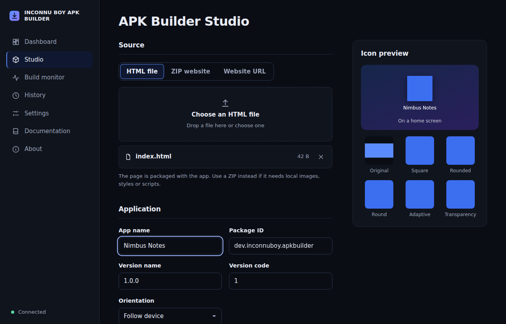
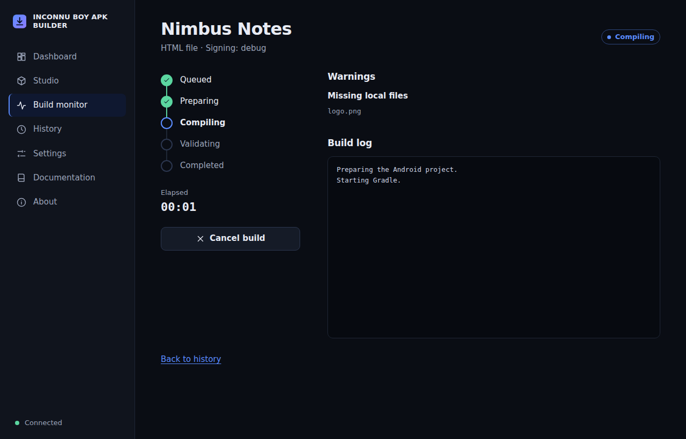
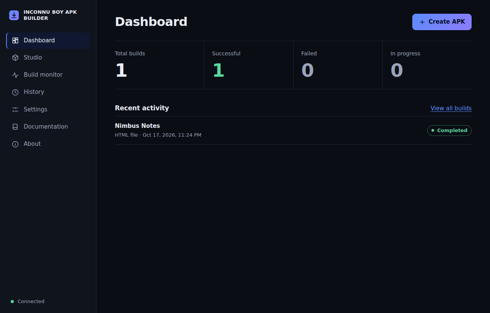
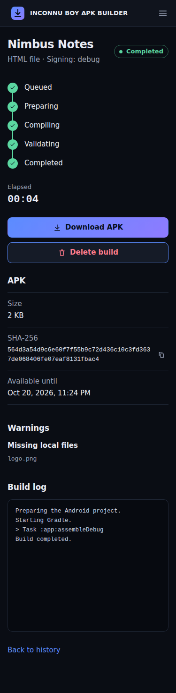

# INCONNU BOY APK BUILDER

Created by INCONNU BOY SENSEI. Upload your website. Customize your icon. Build a real Android APK. Deploy anywhere.

An open-source platform that turns an HTML file, a ZIP static website or a public https address into an installable Android APK, with an intelligent icon generator, a live build monitor and a web interface in English, French and Portuguese.

> **Honest status.** The code, the tests and the documentation are complete for version 0.1.0, but **no real Android build has been run**: this version was written in an environment without network access, Android SDK, Gradle or Docker. Android compilation is therefore **unverified**. See [What was verified](#what-was-verified) before relying on it, and `CHANGELOG.md` for the exact list.

## Features

- Three inputs: an HTML file, a ZIP of a static website (entry point detection, relative paths kept) or a website address shown through WebView.
- Smart Icon Generator: PNG, JPEG and WebP in, Android launcher resources out (all densities, round, adaptive with safe zone, monochrome), with live previews produced by the real pipeline.
- Real Gradle pipeline: isolated workspace per build, bounded queue, live log, cancellation, timeout, APK validation, SHA-256, retention.
- Security first: safe ZIP extraction, SSRF protection, strict validation, per-client ownership of builds, rate limits, unprivileged container.
- Responsive, accessible interface with dark and light themes, offline indicator and no external requests.
- Operations: one-command VPS installer, update with rollback, backup and restore, diagnostics.

## Screenshots

These were captured from the frontend running against the mock API used by the browser tests (the data is not from a real build).

| Studio with icon preview | Build in progress |
| --- | --- |
|  |  |

| Dashboard | On a phone |
| --- | --- |
|  |  |

## Architecture

```
Browser (frontend/)  -->  Express API  -->  SQLite metadata
                              |
                              '--> bounded queue --> build runner --> Gradle --> APK in /data/artifacts
```

One Node.js service serves the interface and the API and runs builds as child processes. There is no separate worker service. Details: `docs/architecture.md`.

## Technology stack

Frontend: HTML, CSS, vanilla JavaScript (ES modules), Fetch with streamed Server-Sent Events. Backend: Node.js 22, Express, Zod, Multer, Sharp, Pino, express-rate-limit, SQLite through `node:sqlite`. Android: Kotlin, WebView, AndroidX WebKit, Android Gradle Plugin 8.7.3, Gradle 8.9. Delivery: Docker, Docker Compose, Caddy. Tests: Node's built-in test runner and Playwright (Chromium).

## Requirements

- Node.js 22.13 or newer.
- For real builds: JDK 17, Gradle 8.9 or newer, an Android SDK with platform 34 and build-tools 34.0.0, about 4 GB of memory per concurrent build, 20 GB of disk, x86_64 Linux (Android's `aapt2` is not available for Linux on ARM).

## Local installation

```
git clone https://github.com/INCONNU-BOY/INCONNU-BOY-APK-BUILDER.git
cd INCONNU-BOY-APK-BUILDER
npm install
cp .env.example .env
```

The repository does not include a `package-lock.json` because it could not be generated offline; `npm install` creates it. Commit it.

### JDK installation

```
sudo apt-get update
sudo apt-get install -y openjdk-17-jdk-headless unzip curl
java -version
```

### Android SDK setup

```
mkdir -p "$HOME/android-sdk/cmdline-tools"
curl -fsSL -o /tmp/tools.zip https://dl.google.com/android/repository/commandlinetools-linux-11076708_latest.zip
unzip -q /tmp/tools.zip -d /tmp/tools
mv /tmp/tools/cmdline-tools "$HOME/android-sdk/cmdline-tools/latest"
yes | "$HOME/android-sdk/cmdline-tools/latest/bin/sdkmanager" --sdk_root="$HOME/android-sdk" --licenses
"$HOME/android-sdk/cmdline-tools/latest/bin/sdkmanager" --sdk_root="$HOME/android-sdk" "platforms;android-34" "build-tools;34.0.0"
```

Install Gradle 8.9 from https://gradle.org/releases/ and put it on your `PATH`, then set in `.env`: `ANDROID_HOME=/home/you/android-sdk`. These commands were not run while writing this project; the command-line tools version is the one the `Dockerfile` uses.

## Environment configuration

`.env.example` lists every variable with its default. `docs/configuration.md` explains each one. Variables are validated at startup and the server refuses to start with an invalid value. Optional integrations stay off when their variables are empty.

## Development commands

```
npm start
npm run dev
npm test
npm run test:browser
npm run test:all
make shell-check
```

`npm run dev` restarts on file changes. `npm test` runs the Node tests; `npm run test:browser` needs Chromium (`npx playwright install chromium`).

## Production commands

```
NODE_ENV=production PUBLIC_BASE_URL=https://apk.example.com TRUST_PROXY=true npm start
```

Prefer the Docker or VPS installation below; put any Node deployment behind an HTTPS reverse proxy that does not buffer `/api/builds/*/events`.

## Docker and Docker Compose

```
cp .env.example .env
mkdir -p data && sudo chown -R 10001:10001 data
docker compose build
docker compose up -d
```

HTTPS with automatic certificates: set `DOMAIN` in `.env` and use `docker compose --profile https up -d`. Details, including build checksum arguments: `docs/deployment/docker.md`.

## One-command VPS deployment

Ubuntu 20.04, 22.04, 24.04 or Debian 11, 12 on x86_64 with 4 GB of memory and 20 GB of free disk. This command is the deployment target and works only once the repository is published at that address:

```
curl -fsSL https://raw.githubusercontent.com/INCONNU-BOY/INCONNU-BOY-APK-BUILDER/main/install.sh -o install.sh && sudo bash install.sh
```

Options: `--domain apk.example.com` for HTTPS, `--version v1.0.0`, `--dir`, `--dry-run`, `--yes`. The installer never replaces an existing installation or `.env`. Afterwards:

```
sudo bash /opt/inconnu-boy-apk-builder/scripts/update.sh
sudo bash /opt/inconnu-boy-apk-builder/scripts/doctor.sh
```

See `docs/deployment/vps.md` for everything the installer does and for HTTPS later with `scripts/set-domain.sh`.

## Hosting guides

All guides are untested. Each says what its configuration file does and what to check on the provider's side. `docs/deployment/README.md` has the overview and the tested-versus-untested table.

- **Railway**: `railway.json`, `docs/deployment/railway.md`. A volume at `/data` is required. No deploy button exists until a Railway template is published.
- **Render**: `render.yaml`, `docs/deployment/render.md`. Needs a paid plan with a persistent disk.
- **Fly.io**: `fly.toml`, `docs/deployment/fly.md`. One machine with a volume.
- **DigitalOcean**, **Hetzner**, **Oracle Cloud**, **AWS**, **Google Cloud**, **Azure**: virtual machine guides that reuse the VPS installer (`docs/deployment/digitalocean.md`, `hetzner.md`, `oracle.md`, `aws.md`, `gcp.md`, `azure.md`). Arm instances are not supported, which excludes Oracle's Always Free Ampere shapes.
- **Vercel and Netlify**: frontend only, pointing at an API hosted elsewhere (`docs/deployment/frontend-only.md`). The Android build cannot run in serverless functions.

## HTML upload guide

Choose "HTML file". The page is packaged as `index.html` and served inside the app from `https://appassets.androidplatform.net/assets/www/`. It must be a UTF-8 text file. Images, styles and scripts it references are not included; the platform warns about missing local files and about external resources, which need internet access on the device. Use a ZIP when you have local assets.

## ZIP upload guide

Choose "ZIP website". Put `index.html` at the top level or inside a single folder. Relative paths are preserved. If several HTML files exist and none is named `index.html`, the build is refused with the list of candidates. Archives with symlinks, absolute or parent paths, encryption, ZIP64, too many files, excessive size or suspicious compression are rejected. Android may skip files whose names start with a dot and folders starting with an underscore; the platform warns when your archive contains them. A working example is in `examples/sample-site/`.

## Website URL guide

Choose "Website URL" and enter an https address. The server checks that it is public and reachable (redirects are followed and revalidated, private networks are refused) and the app displays the live site. It needs an internet connection and not every website can be embedded: some forbid it or require features WebView lacks. The platform does not mirror the site and offers no offline mode for addresses.

## Smart Icon Generator

Upload PNG, JPEG or WebP; the platform validates it by content, corrects orientation, keeps the aspect ratio and transparency, and generates every resource from that image. Scale, padding, position, background, adaptive background and fit mode all change the files compiled into the APK; the previews come from the same code. Details and the exact rules: `docs/icons.md`.

## Android icon resources

Launcher icons from 48 to 192 pixels with round variants, adaptive foregrounds on a 108dp canvas kept inside the 66dp safe zone, a monochrome layer, adaptive XML in `mipmap-anydpi-v26` and a background color resource. The manifest references `@mipmap/ic_launcher` and `@mipmap/ic_launcher_round`; a test verifies it. The appearance on a real device has not been checked.

## Debug signing

Builds use Gradle's `assembleDebug`, which signs with an automatically generated debug key stored under `data/build-home`. Debug-signed APKs install directly for testing and cannot be published to Google Play. When the Android build tools are present the platform also runs `apksigner verify` and `aapt2 dump badging`; otherwise it reports those checks as skipped.

## User-owned release signing

Not implemented. A request with `"signing": "release"` is refused. No keystore is stored or accepted by this version, and no shared release key exists or will.

## API documentation

`docs/api.md` documents every endpoint, request and response shape, the authentication headers and every error code. Usage examples with `curl`: `examples/api-usage.md`.

## Security model

`docs/security.md` lists each protection with the tests that cover it, and the known limits (uploads buffered in memory, no sandbox beyond the container, unrestricted Gradle egress, a token that separates visitors but is not user authentication). Report vulnerabilities as described in `SECURITY.md`.

## Rate limits

Per client address, `RATE_LIMIT_MAX` requests every `RATE_LIMIT_WINDOW_SECONDS` (default 120 per 60 seconds). Build creation allows one sixth of that, at least 5. Each access token may have `MAX_ACTIVE_BUILDS_PER_CLIENT` builds in progress (default 3) and `MAX_STORAGE_MB_PER_CLIENT` of APKs (default 500). Behind a proxy set `TRUST_PROXY=true`.

## Build queue

At most `WORKER_CONCURRENCY` builds run at once (default 1); up to `QUEUE_LIMIT` wait (default 20) and a full queue answers `queue_full`. A build running longer than `BUILD_TIMEOUT_SECONDS` (default 900) is killed. Builds interrupted by a restart are marked failed.

## Artifact retention

Finished builds, their logs and their APKs are deleted `ARTIFACT_RETENTION_HOURS` after they end (default 72). You can delete a finished build earlier from the interface or the API. Workspaces are deleted after every build and stale ones are swept after six hours.

## Backup and restore

```
sudo bash /opt/inconnu-boy-apk-builder/scripts/backup.sh
sudo bash /opt/inconnu-boy-apk-builder/scripts/restore.sh /var/backups/inconnu-boy-apk-builder/backup-YYYYmmdd-HHMMSS.tar.gz
```

Backups snapshot SQLite consistently while the service runs, include the APKs and by default `.env`, and are written with mode 600. Restore validates the archive and the database before touching anything, keeps the previous data aside and reverts if the service is unhealthy. Copy backups off the server.

## Updating the application

```
sudo bash /opt/inconnu-boy-apk-builder/scripts/update.sh
sudo bash /opt/inconnu-boy-apk-builder/scripts/update.sh --version v1.1.0
```

The script backs up first, preserves `.env`, metadata and artifacts, rebuilds, checks health and rolls back automatically on failure.

## Troubleshooting

| Symptom | Cause and fix |
| --- | --- |
| "The Android SDK is not configured" | Set `ANDROID_HOME` (the Docker image does it for you). |
| "The Gradle executable could not be started" | `GRADLE_COMMAND` is wrong or Gradle is not installed. |
| Gradle fails downloading dependencies | The server needs outbound HTTPS to Google Maven and Maven Central. |
| Build killed or out of memory | Give the container at least 4 GB per concurrent build, or lower `WORKER_CONCURRENCY`. |
| "Several HTML files were found" | Name the main page `index.html` in the ZIP. |
| A website app shows a retry screen | The device is offline or the site refuses embedding. |
| Browser blocks API calls from a separate frontend | Add the frontend origin to `ALLOWED_ORIGINS` and use an https API address. |
| Rate limited for everyone at once | Set `TRUST_PROXY=true` behind a reverse proxy. |
| Live log stops behind a proxy | Disable response buffering for `/api/builds/*/events`. |
| Diagnose an installation | `sudo bash /opt/inconnu-boy-apk-builder/scripts/doctor.sh` |

## Known limitations

- Android compilation has never been run; the pipeline is tested with a stubbed Gradle.
- Builds need x86_64 hosts. Arm hosts are unsupported.
- Builds run inside the web service process. There is no separate worker service, distributed queue or S3-compatible object storage.
- Gradle needs the internet; build egress is not blocked.
- Only debug signing is available.
- Express, Multer, Zod, Pino and express-rate-limit code paths were never executed; dependency and tool versions are unverified.
- Remote-website apps need internet and cannot be made offline. Not every site can be embedded.
- Android may skip dot files and underscore-prefixed folders in packaged sites.
- All hosting guides and the Docker image are untested.

## Testing

`npm test` runs the Node tests and `npm run test:browser` runs the Chromium tests; `npm run test:all` runs both. They need no network.

### What was verified

- Passing automated tests (run twice in a row) for configuration, SSRF and URL probing, ZIP safety, HTML and ZIP ingestion, the icon generator, the build configuration, the Android project writer, the Gradle process runner, APK validation, the build service and runner (with a stubbed Gradle executable), SQLite persistence and retention, the queue, the installer and maintenance scripts (with a stubbed Docker), configuration files, documentation consistency, the examples and, in Chromium against a mock of the API, the whole interface.
- Repository rules checked by tests: no comments in any source or configuration file, every environment variable and API route and error code documented, documented scripts and links exist.

### What was not verified

- A real Gradle build and APK, installation of the APK on a device, and the on-device appearance of the icon.
- The real Express server, Zod validation, Multer uploads, Pino logging and rate limiting (syntax checked only).
- Building the Docker image, running the installer or `docker compose` for real, certificate issuance, every cloud or hosting platform, GitHub Actions runs, `shellcheck`, `npm audit`.
- Accessibility measured with dedicated tools.

## Contributing

See `CONTRIBUTING.md` and `CODE_OF_CONDUCT.md`. The most valuable contribution right now is running a real build and reporting what happens.

## License

MIT, see `LICENSE`. Third-party packages keep their own licenses.

## Credits

INCONNU BOY APK BUILDER, created by INCONNU BOY SENSEI.
